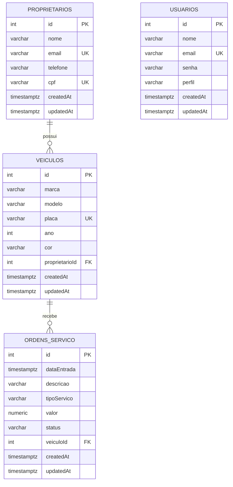

# Atividade: lava-car

## Problema

Um lava-car precisa organizar seus clientes, os carros que eles possuem e as lavagens realizadas. O sistema reúne esses dados para facilitar a consulta e o acompanhamento dos serviços.

## Telas e campos

- Login: e-mail e senha.
- Proprietários: nome, e-mail, telefone e CPF, todos obrigatórios. A tela também permite buscar por nome ou e-mail.
- Veículos: marca, modelo, placa e proprietário obrigatórios. Ano e cor são opcionais.
- Serviços: veículo, tipo de serviço, descrição e valor obrigatórios. A data de entrada é preenchida pelo banco e o status inicial é aberto.

Depois do login, o funcionário usa os botões do menu para mudar de tela e pode sair pelo botão Sair.

## Regras

Um proprietário pode ter vários veículos. Cada veículo pertence a um proprietário.
Um veículo pode ter vários serviços. Cada serviço pertence a um veículo.
Se o proprietário ou veículo não existir, a chave estrangeira impede o cadastro.
A placa identifica o carro e não pode se repetir. E-mail e CPF de proprietários também são únicos.
Quando um serviço é concluído, seu status muda para concluido e o registro fica no histórico.
Os tipos usados são lavagem simples, lavagem completa, higienização interna, polimento e enceramento.

## Banco de dados

- usuarios: id, nome, email, senha, perfil, createdAt e updatedAt.
- proprietarios: id, nome, email, telefone, cpf, createdAt e updatedAt.
- veiculos: id, marca, modelo, placa, ano, cor, proprietarioId, createdAt e updatedAt.
- ordens_servico: id, dataEntrada, descricao, tipoServico, valor, status, veiculoId, createdAt e updatedAt.

## DER

## Como conferir a busca

Abra a aba Network do navegador e pesquise um proprietário. Deve aparecer uma requisição GET para `/api/proprietarios?busca=texto`. No controller, o texto é passado como parâmetro do SELECT com ILIKE.

## Testes manuais

1. Entrar com o usuário de exemplo e depois testar uma senha errada (401).
2. Acessar a API sem token (401) e com token expirado (401).
3. Cadastrar e pesquisar um proprietário. Conferir que o CPF não aparece na resposta.
4. Cadastrar um veículo, conferir o nome do proprietário e tentar repetir a placa.
5. Tentar usar um proprietário ou veículo inexistente. O cadastro deve falhar.
6. Cadastrar uma lavagem e conferir o vínculo com o veículo e o proprietário.
7. Alterar o status da lavagem e tentar enviar um status inválido.
8. Executar o seed duas vezes e conferir que continuam três registros de exemplo por tabela em um banco novo.
